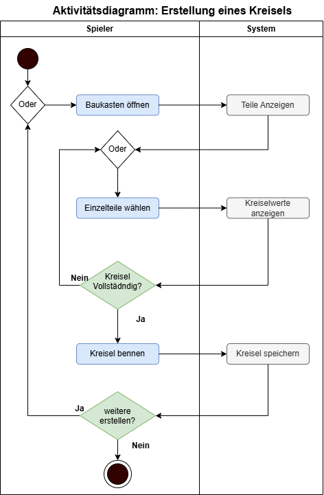
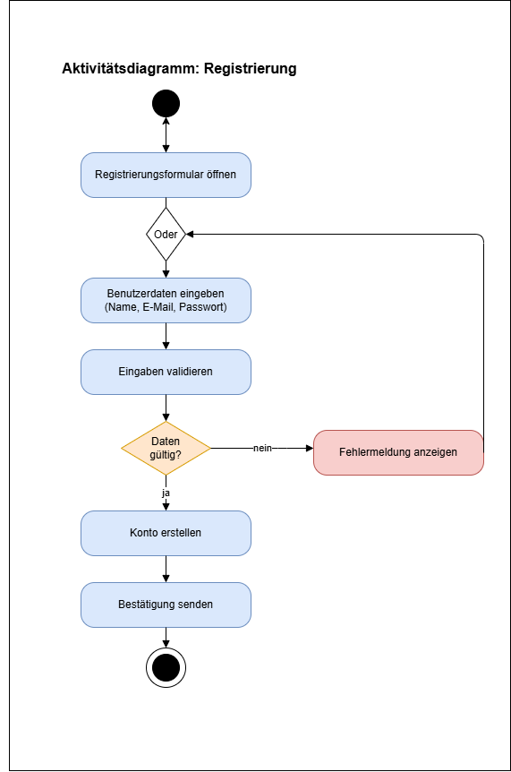
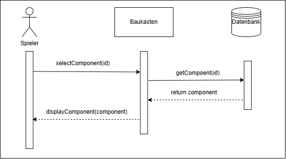
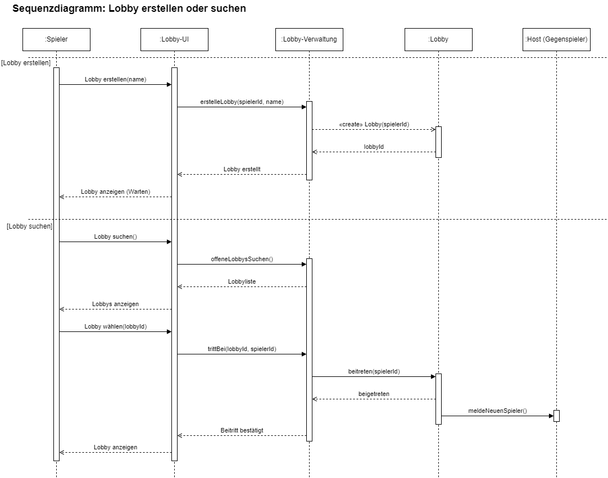

# Kreiselkämpfe
## Softwareanforderungen

### 1. Einleitung

#### 1.1 Übersicht
Kreiselkämpfe ist ein digitales Spiel, das sich am Prinzip von Beyblade orientiert. Spieler können verschiedene Kreisel auswählen und diese in einer Arena gegeneinander antreten lassen. Ziel ist es, den gegnerischen Kreisel zu besiegen.

#### 1.2 Geltungsbereich
Dieses Dokument beschreibt die funktionalen und nicht-funktionalen Anforderungen an Kreiselkämpfe. Der Schwerpunkt liegt auf der Spielmechanik und der Benutzeroberfläche.

#### 1.3 Definitionen und Abkürzungen
- **Arena:** Spielfeld, in dem die Kreisel gegeneinander antreten.
- **Kreisel:** Spielobjekt, das vom Spieler oder Computer gesteuert wird.
- **UI:** User Interface (Benutzeroberfläche).

#### 1.4 Referenzen
N.N.
### 2. Funktionale Anforderungen

#### 2.1 Übersicht

In Kreiselkämpfe treten zwei Kreisel in einer Arena gegeneinander an. Die Kreisel besitzen unterschiedliche Eigenschaften und verlieren während des Kampfes Energie.

Zunächst wird auf 2 wesentliche Funktionen eingegangen:

- **Kreisel zusammenstellen:** Der Spieler wählt einen Kreisel mit bestimmten Eigenschaften aus mit dem er den Kampf bestreiten will.
- **Online-Kampf bestreiten:** Dem Spieler wird ein Gegner zugewiesen und das Ergebnis des Kampfes gespeichert.

  Nun werden weitere Anwendungsfälle mit Aktivitäts- bzw. Sequenzdiagramm ergänzt (Update 22.10.):
- **Kreisel zusammenstellen:** Update mit Aktivitätsdiagramm
- **Registrierung:** Aufnahme eines Nutzerprofils mit Kontodaten
- **Kreiselkomponente auswählen:** Auswahl und korrekte Ausgabe einer Komponente
- **Lobbyerstellung:** Erstellung und Beitreten zu einer Lobby
-  **Rangliste:**

**UML-Anwendungsfalldiagramm:**

#### 2.2 Kreisel zusammenstellen *(inkl. Einzelteile wählen + Kreiselwerte anzeigen)*

**Als Spieler** möchte ich vor einem Kampf einen Kreisel auswählen und konfigurieren können, um mit unterschiedlichen Eigenschaften gegen einen Gegner anzutreten.

**Akzeptanzkriterien:**
- Es stehen mindestens zwei unterschiedliche Kreisel zur Auswahl.
- Die Eigenschaften der Kreisel (z. B. Angriff, Geschwindigkeit und Ausdauer) werden angezeigt.
- Nach der Auswahl startet der Kampf mit dem gewählten Kreisel.

**Aktivitätsdiagramm:**
Das Aktivitätsdiagramm zeigt die Ablaufmöglichkeiten bei der Erstellung eines Kreisels. Zunächst öffnet der Spieler den Baukasten, um dann Einzelteile zu wählen, bis der Kreisel vollständig konfiguriert ist. Danach wird der Kreisel benannt und gespeichert und der Nutzer hat die Möglichkeit einen weiteren zu erstellen. Hier wird in der Darstellung zusätzlich zwischen Spieler und System unterschieden, was eine bessere Verständlichkeit ermöglichen soll.

#### 2.3 Online-Kampf bestreiten

**Als Spieler** möchte ich mit meinem Kreisel einen Gegner finden und dass anschließend das Ergebnis des Kampfes gespeichert wird.

**Akzeptanzkriterien:**
- Kreisel wird korrekt konfiguriert in den Kampf übernommen
- Gegnerzuweisung dauert max 20 Sekunden
- Ergebnis wird gespeichert und ist einsehbar
  

#### 2.4 Registrierung
**Als Spieler** möchte ich einen funktionierenden Account erstellen können.

**Akzeptanzkriterien:**
- Fehlermeldung bei falscher Eingabe wird angezeigt
- Felder lassen sich in der Anwendung ausfüllen
- Konto in der Datenbank
- Bestätigung ausgesandt

**Aktivitätsdiagramm:**
Das Aktivitätsdiagramm zeigt den Ablauf eines Registrierungsprozesses. Die Schlüsseloperationen sind die Prüfung der Daten (falls nein Rückkehr zur Blankoeingabe; falls ja Erstellung des Kontos + Bestätigung.

#### 2.5 Kreiselkomponente auswählen
**Als Spieler** möchte ich bei der Erstellung eines Kreisels eine Komponente auswählen können und diese daraufhin korrekt an meinem Kreisel implementiert sehen. 

**Akzeptanzkriterien:**
- Komponente kann ausgewählt werdne
- Komponente wird korrekt übertragen
- Ausgewählte Komponente wird angezeigt

**Sequenzdiagramm:**
Das Sequenzdiagramm zeigt, wie der Ablauf bei der Auswahl einer Komponente funktionieren soll. Zunächst wählt der Spieler eine Komponente aus dem Baukasten. Diese Auswahl wird dann in der Datenbank verarbeitet und die Komponente wird "returned"/freigegeben. Daraufhin wird sie dem Nutzer angezeigt.

#### 2.6 Erstellung einer Lobby
**Als Spieler** möchte ich eine neue Lobby erstellen bzw. einer bestehenden beitreten können.

**Akzeptanzkriterien:**
- Der Spieler kann eine neue Lobby erstellen und ihr einen Namen geben.
- Das System erstellt die Lobby und weist ihr eine eindeutige Lobby-ID zu.
- Nach erfolgreicher Erstellung wird dem Spieler die Lobby angezeigt, in der er auf weitere Mitspieler warten kann.

**Sequenzdiagramm:**
Das Sequenzdiagramm „Lobby erstellen“ zeigt folgenden Ablauf:
1. Lobby erstellen: Der Spieler gibt einen Namen für die Lobby ein.
2. Anfrage weiterleiten: Die Lobby-UI übermittelt die Anfrage an die Lobby-Verwaltung.
3. Lobby erzeugen: Die Lobby-Verwaltung erstellt eine neue Lobby mit der Spieler-ID.
4. Bestätigung: Die erstellte Lobby gibt ihre Lobby-ID zurück.
5. Lobby anzeigen: Der Spieler erhält eine Bestätigung und sieht die erstellte Lobby im Wartezustand.
 Das Diagramm beschreibt, wie ein Spieler eine neue Lobby erstellt und anschließend auf weitere Mitspieler wartet.

### 3. Nicht-funktionale Anforderungen

- **Benutzerfreundlichkeit:** Das Spiel soll einfach und intuitiv bedienbar sein.
- **Zuverlässigkeit:** Das Spiel soll stabil und möglichst fehlerfrei laufen.

### 4. Technische Einschränkungen

- Die Versionsverwaltung erfolgt über GitHub.
