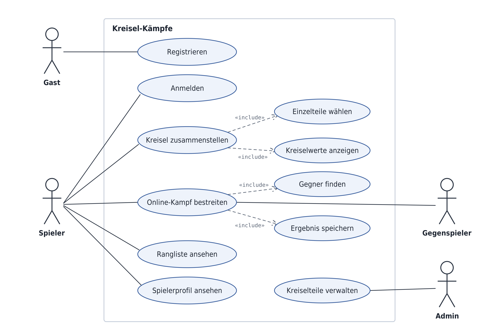

# Kreiselkämpfe
## Softwareanforderungen

### 1. Einleitung

#### 1.1 Übersicht
Kreiselkämpfe ist ein digitales Spiel, das sich am Prinzip von Beyblade orientiert. Spieler können verschiedene Kreisel auswählen und diese in einer Arena gegeneinander antreten lassen. Ziel ist es, den gegnerischen Kreisel zu besiegen.

#### 1.2 Geltungsbereich
Dieses Dokument beschreibt die funktionalen und nicht-funktionalen Anforderungen an Kreiselkämpfe. Der Schwerpunkt liegt auf der Spielmechanik und der Benutzeroberfläche.

#### 1.3 Definitionen und Abkürzungen
- **Arena:** Spielfeld, in dem die Kreisel gegeneinander antreten.
- **Kreisel:** Spielobjekt, das vom Spieler oder Computer gesteuert wird.
- **UI:** User Interface (Benutzeroberfläche).

#### 1.4 Referenzen
N.N.
### 2. Funktionale Anforderungen

#### 2.1 Übersicht

In Kreiselkämpfe treten zwei Kreisel in einer Arena gegeneinander an. Die Kreisel besitzen unterschiedliche Eigenschaften und verlieren während des Kampfes Energie.

Zunächst wird auf 2 wesentliche Funktionen eingegangen:

- **Kreisel zusammenstellen:** Der Spieler wählt einen Kreisel mit bestimmten Eigenschaften aus mit dem er den Kampf bestreiten will.
- **Online-Kampf bestreiten:** Der Spieler steuert seinen Kreisel und versucht, den gegnerischen Kreisel zu besiegen.

**UML-Anwendungsfalldiagramm:**

#### 2.2 Kreisel zusammenstellen *(inkl. Einzelteile wählen + Kreiselwerte anzeigen)*

**Als Spieler** möchte ich vor einem Kampf einen Kreisel auswählen und konfigurieren können, um mit unterschiedlichen Eigenschaften gegen einen Gegner anzutreten.

**Akzeptanzkriterien:**
- Es stehen mindestens zwei unterschiedliche Kreisel zur Auswahl.
- Die Eigenschaften der Kreisel (z. B. Angriff, Geschwindigkeit und Ausdauer) werden angezeigt.
- Nach der Auswahl startet der Kampf mit dem gewählten Kreisel.

**Priorität:** Hoch  
**Geschätzter Aufwand:** Mittel

#### 2.3 Online-Kampf bestreiten

**Als Spieler** möchte ich mit meinem Kreisel einen Gegner finden und dass anschließend das Ergebnis des Kampfes gespeichert wird.

**Akzeptanzkriterien:**
- Kreisel wird korrekt konfiguriert in den Kampf übernommen
- Gegnerzuweisung dauert max 20 Sekunden
- Ergebnis wird gespeichert und ist einsehbar
  

**Priorität:** Hoch  
**Geschätzter Aufwand:** Hoch

### 3. Nicht-funktionale Anforderungen

- **Benutzerfreundlichkeit:** Das Spiel soll einfach und intuitiv bedienbar sein.
- **Zuverlässigkeit:** Das Spiel soll stabil und möglichst fehlerfrei laufen.

### 4. Technische Einschränkungen

- Die Versionsverwaltung erfolgt über GitHub.
