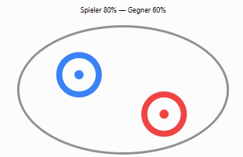
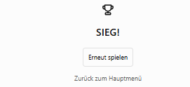

# Kreiselkämpfe
## Softwareanforderungen

### 1. Einleitung

#### 1.1 Übersicht
Kreiselkämpfe ist ein digitales Spiel, das sich am Prinzip von Beyblade orientiert. Spieler können verschiedene Kreisel auswählen und diese in einer Arena gegeneinander antreten lassen. Ziel ist es, den gegnerischen Kreisel zu besiegen.

#### 1.2 Geltungsbereich
Dieses Dokument beschreibt die funktionalen und nicht-funktionalen Anforderungen an Kreiselkämpfe. Der Schwerpunkt liegt auf der Spielmechanik und der Benutzeroberfläche.

#### 1.3 Definitionen und Abkürzungen
- **Arena:** Spielfeld, in dem die Kreisel gegeneinander antreten.
- **Kreisel:** Spielobjekt, das vom Spieler oder Computer gesteuert wird.
- **UI:** User Interface (Benutzeroberfläche).

#### 1.4 Referenzen
N.N.
### 2. Funktionale Anforderungen

#### 2.1 Übersicht

In Kreiselkämpfe treten zwei Kreisel in einer Arena gegeneinander an. Die Kreisel besitzen unterschiedliche Eigenschaften und verlieren während des Kampfes Energie.

Die drei wesentlichen Anwendungsfälle sind:

- **Kreisel auswählen und Kampf starten:** Der Spieler wählt einen Kreisel mit bestimmten Eigenschaften aus und beginnt einen Kampf.
- **Kreiselkampf durchführen:** Der Spieler steuert seinen Kreisel und versucht, den gegnerischen Kreisel zu besiegen.
- **Kampf beenden und erneut spielen:** Nach dem Kampf wird der Gewinner angezeigt und eine neue Runde kann gestartet werden.

**UML-Anwendungsfalldiagramm:**

#### 2.2 Kreisel auswählen und Kampf starten

**Als Spieler** möchte ich vor einem Kampf einen Kreisel auswählen können, um mit unterschiedlichen Eigenschaften gegen einen Gegner anzutreten.

**Akzeptanzkriterien:**
- Im Hauptmenü kann ein neuer Kampf gestartet werden.
- Es stehen mindestens zwei unterschiedliche Kreisel zur Auswahl.
- Die Eigenschaften der Kreisel (z. B. Angriff, Geschwindigkeit und Ausdauer) werden angezeigt.
- Nach der Auswahl startet der Kampf mit dem gewählten Kreisel.

**Priorität:** Hoch  
**Geschätzter Aufwand:** Mittel

#### 2.3 Kreiselkämpfe durchführen

**Als Spieler** möchte ich meinen Kreisel während eines Kampfes steuern und mit dem gegnerischen Kreisel zusammenstoßen können, um den Kampf aktiv zu beeinflussen und meinen Gegner zu besiegen.

**Akzeptanzkriterien:**
- Zwei Kreisel bewegen sich innerhalb einer begrenzten Arena.
- Der Spieler kann die Bewegungsrichtung seines Kreisels beeinflussen.
- Der gegnerische Kreisel wird automatisch gesteuert.
- Bei Zusammenstößen reagieren die Kreisel aufeinander und verlieren gegebenenfalls Energie.
- Die verbleibende Energie beider Kreisel wird angezeigt.

**Priorität:** Hoch  
**Geschätzter Aufwand:** Hoch

#### 2.4 Kampf beenden und erneut spielen

**Als Spieler** möchte ich nach einem Kampf das Ergebnis sehen und eine neue Runde starten können, um mehrere Kämpfe hintereinander spielen zu können.

**Akzeptanzkriterien:**
- Der Kampf endet, sobald die Energie eines Kreisels auf null sinkt oder er die Arena verlässt.
- Das Spiel erkennt automatisch den Gewinner.
- Das Ergebnis wird auf dem Bildschirm angezeigt.
- Der Spieler kann einen neuen Kampf starten oder zum Hauptmenü zurückkehren.

**Priorität:** Hoch  
**Geschätzter Aufwand:** Niedrig

### 3. Nicht-funktionale Anforderungen

- **Benutzerfreundlichkeit:** Das Spiel soll einfach und intuitiv bedienbar sein.
- **Zuverlässigkeit:** Das Spiel soll stabil und möglichst fehlerfrei laufen.

### 4. Technische Einschränkungen

- Die Versionsverwaltung erfolgt über GitHub.
