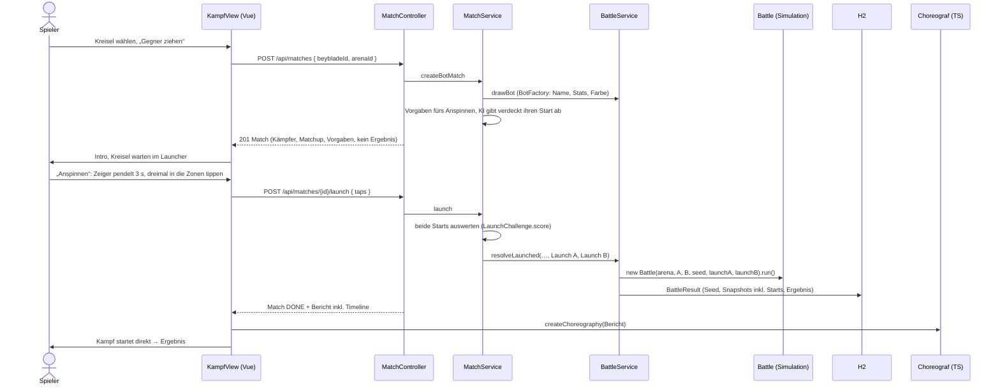

# Kampfsystem

Ein Spieler kämpft mit einem seiner Kreisel gegen einen KI-Gegner mit zufälligen Werten (Schnelles Match)
oder gegen einen anderen Spieler (Lobby). Der Server simuliert den Kampf wahrscheinlichkeitsbasiert und
liefert neben dem Ergebnis eine kompakte **Timeline**. Das Frontend erzeugt daraus mit einem
**deterministischen Choreografen** die 3D-Animation. Das Ergebnis kommt immer vom Server, das Frontend
würfelt nichts, was das Ergebnis beeinflusst.

## Ablauf



`GET /api/battles/{id}` spielt einen gespeicherten Kampf auf dieselbe Weise nach (Replay aus Lobby und
Profil). Der alte Endpunkt `POST /api/battles/bot` (sofort simuliert, ohne Anspinnen) bleibt erhalten.

## Anspinnen (`LaunchChallenge`, `LaunchRules`, `MatchService`)

Jede Runde gegen die KI beginnt mit dem **Schwungmesser**. Ein Zeiger pendelt über einen Bogen, an den Enden
langsam, in der Mitte schnell. Auf dem Bogen liegen drei Zonen (orange) mit schmalem Kern (türkis). Der
Spieler hat **3 Sekunden und genau 3 Taps** (Klick, Finger oder Leertaste). Jeder Tap zählt für die Zone,
in der der Zeiger gerade steht, jede Zone höchstens einmal. Ein Tap daneben ist verschenkt.

```
Zeiger      p(t) = ½ − ½ · cos(2π · t / Periode)          Periode 1250–1450 ms je Match
Zonen       drei Mitten in 0,12–0,88, mindestens 0,22 auseinander, je Match neu
Zonenwert   Kern (±0,014): 1   Rand der Zone (±0,05): 0,5   dazwischen linear   daneben: 0
Qualität q  = (Summe der besten Werte der drei Zonen) / 3
Perfekt     alle drei Zonen, q ≥ 0,97 (praktisch: alle drei Kerne)
Flugweite   Landepunkt im Abschussrahmen x = −1 + 0,25 + 0,3 · q (besser = weiter in die Bowl)
```

In der Bogenmitte überstreicht der Zeiger eine ganze Zone in rund 45 ms und einen Kern in rund 13 ms. Alle
drei zu treffen ist deshalb sehr schwer, die Abstufungen dazwischen sind fein. Urteile: Perfekt!,
Hervorragend!/Volltreffer! (3/3), Stark!/Gut (2/3), Okay/Wackelig (1/3), Daneben! (0/3).

Die KI (`BotLauncher`) nimmt sich die Zonen der Reihe nach vor und tippt mit menschlicher Streuung
(σ ≈ 56 ms bei mittlerer Stärke). Ergebnis: im Schnitt q ≈ 0,32, 21 % keine Zone, 46 % eine, 28 % zwei,
5 % alle drei, 0,3 % perfekt.

Wirkung in der Simulation (`BattleTuning`, Simulationsversion 2):

```
Startenergie   E0 = 0,835 + 0,045 · q + 0,12 · U(0, 1)
Initiative     bis 8 s: Angriffsgewicht A · (1 + 0,25 · (qA − qB)), B · (1 − 0,25 · (qA − qB))
```

Der Zufallsanteil ist bewusst so breit wie die alte gewürfelte Startenergie (0,86–1), damit das
Archetyp-Balancing hält. Monte Carlo (`LaunchTest`, `LaunchBalanceTest`):

| Fall | Siegquote |
|---|---|
| Mirror, perfekter gegen schwachen Start (q 1 gegen 0,35) | 63–64 % |
| Mirror, perfekter gegen verpassten Start | 69–71 % |
| Vorteil-Typ mit schwachem Start gegen perfekten Gegner | 51–58 % |
| Vorteil-Typen bei typischen Starts (D>A, S>D, A>S) | 68,8 / 67,4 / 63,2 % |
| Mirrors bei typischen Starts | 49–51 % |

Skill gibt also in engen Kämpfen den Ausschlag, Teile und Matchup bleiben wichtiger.

**Server-autoritativ und PvP-tauglich:**

- Ein Match hat zwei gleichwertige Plätze. Der KI-Gegner ist nur ein Platz, der seine Taps sofort und
  verdeckt abgibt. Er kennt die Eingabe des Spielers nicht.
- Der Client schickt nur rohe Werte: die Zeitpunkte der Taps (`taps`) ab dem Start des Zeigers auf seinem
  eigenen Gerät.
  Gewertet wird nur auf dem Server, die Latenz spielt keine Rolle. Unplausible Eingaben zählen als
  verpasst.
- Vor dem Kampf liefert das Match nie den Start des Gegners. Der Seed entsteht erst beim Auswerten.
- Frist: Wer 120 s nach Match-Start nicht angespinnt hat, bekommt einen verpassten Start. So kann
  niemand ein Match blockieren (`MatchServiceTimeoutTest`).
- Matches leben wie Lobbys im Speicher. Gespeichert wird der fertige Kampf mit beiden Starts.

**Für PvP fehlt nur noch:** ein Matchmaking-Einstieg, der beide Plätze mit Menschen besetzt, ein
gemeinsamer Bereit-Schritt, ab dem beide Countdowns starten, und Push statt Nachfragen (WebSocket oder
SSE). Anspinnen, Auswertung und Speichern laufen unverändert. Der Client fragt heute schon per
`GET /api/matches/{id}` nach, bis der Kampf da ist.

Im Frontend (`game/launch.ts`, `components/battle/LaunchPad.vue`) zeigt eine Vorschau mit denselben
Formeln Zähler („2/3“) und Urteil sofort an. Die Kreisel warten bis dahin im Launcher (`game/standby.ts`),
der eigene dreht mit jedem Treffer schneller. Die Ruheposition ist genau das erste Bild der Choreografie
(`LAUNCH_THETA`: eigener links, Gegner rechts). Im Kampf fliegt jeder Kreisel in 0,55 s in einem Bogen vom
Launcher zu seinem Landepunkt, setzt mit Funken und Aufschlagring auf und startet von da, auch im Replay.

## Simulation (`org.example.game`)

### Normalisierung und Stil

Die Stats aus den Teilen liegen in sehr unterschiedlichen Bereichen (Angriff 1–7, Verteidigung 3–12,
Ausdauer 6–16, Dash 2–8, Gewicht 71–86, Burst-Resistenz 2–4). Jeder Wert wird deshalb auf das erreichbare
Maximum normalisiert. `TuningCatalogTest` prüft die Referenzwerte gegen `parts/*.json`.

```
a = attack/7   d = defense/12   s = stamina/16   v = dash/8   b = burstResistance/4
m = (weight − 71) / 15                                  (alle auf [0, 2] begrenzt)

Budget P = a + d + s          Stil σ = (a, d, s) / P
Archetyp = größter Anteil, wenn ≥ 0,42, sonst BALANCE   (nur Anzeige)
```

Die **Matchup-Kante** wird nur für den Hinweis im Intro genutzt:

```
e(X, Y) = σXᵀ · M · σY        M (Zeile schlägt Spalte):
                                     A   D   S
                                A [  0  -1  +1 ]
                                D [ +1   0  -1 ]
                                S [ -1  +1   0 ]
```

M ist antisymmetrisch. Ein Mirror ergibt 0, ein ausgeglichener Stil ergibt gegen jeden Gegner 0. Ab
|e| < 0,05 zeigt die UI „Ausgeglichen“.

### Tick-Simulation

20 Ticks/s, Zeitlimit 35 s, keine KOs vor 12 s (Rampe bis 16 s). Daraus folgt eine Kampfdauer von
12–35 s.

| Phase | Zeit | Verhalten |
|---|---|---|
| Launch | 0–1 s | keine Kollisionen |
| Tornado | 1–3,5 s | seltene, schwache Kontakte (×0,35 Rate, ×0,5 Intensität) |
| Angriff | ab 3,5 s | volle Clash-Rate |
| Ende | | BURST, RING_OUT, SPIN_OUT oder DECISION |

Pro Tick:

```
Reibung   F = F0 · Arena · Jitter · (1 + 0,02·m + 0,03·d) · (1 − 0,11·s) · (1 + 0,8·max(0, 0,3 − E)/0,3)
Clash     P = 1 − exp(−λ·dt),  λ = 0,75 · Phase · Tempo · (0,35 + v_A·(0,3+σA,a) + v_B·(0,3+σB,a))
          mindestens 0,7 s zwischen zwei Clashes
Angreifer P(X) ∝ 0,15 + a_X + 0,5·v_X
Intensität I = 0,95 · (0,3 + 0,6·a + 0,5·m) · (0,75 + 0,25·v) · √E · √(wX/wY) · U(0,65…1,35)
               · (1 − 0,58·σY,s)                     (Ausdauer weicht aus)
Abwehr    P = clamp(0,25 + 0,8·(d_Y − 0,6·a_X), 0,05, 0,85)
            → Angreifer verliert 0,021·I·wY/wX·(0,5+0,5·d_Y), kann sich selbst rausschießen
Treffer   Verteidiger −0,05·I·(1 − 0,45·d_Y), Angreifer −0,025·I
Burst     0,12 · I² · (1 − 0,7·b) · (1 + σY,s) · (1 + 2·(1−E)) · KO-Rampe
Ring-Out  0,08 · I² · (1,4 − m) · (1 − 0,5·d) · (1 + 2·(1−E)) · KO-Rampe · Arena
```

So entsteht Schere-Stein-Papier, ohne feste Sieger:

- **Verteidigung schlägt eher Angriff.** Treffer prallen ab, der Angreifer verliert durch den Rückstoß
  Spin oder schießt sich selbst raus.
- **Ausdauer schlägt eher Verteidigung.** Weniger Reibung, der schwere Verteidiger dreht kürzer.
- **Angriff schlägt eher Ausdauer.** Der leichte, locker gebaute Ausdauer-Kreisel burstet oder fliegt
  raus.

Alle Konstanten stehen kommentiert in `BattleTuning`.

### Determinismus

`new Battle(arena, a, b, seed)` liefert bei gleichem Seed exakt dasselbe Ergebnis und dieselbe Timeline:

- Der Seed wird mit SplitMix64 gemischt, weil aufeinanderfolgende Seeds bei `java.util.Random` sonst
  korrelierte erste Werte liefern.
- Die Simulation nutzt `java.util.Random` (plattformunabhängig spezifiziert) und `StrictMath` statt
  `Math`.
- Seeds sind kleiner als 2⁵³, damit JavaScript sie exakt darstellt.

### Balancing (Monte Carlo, `BattleBalanceTest`)

Reine Archetypen mit gleichem Budget, Seeds 0–4999, beide Seiten-Reihenfolgen:

| Matchup | Vorteil-Typ gewinnt |
|---|---|
| Verteidigung vs Angriff | 68,5 % / 69,0 % |
| Ausdauer vs Verteidigung | 66,7 % / 68,0 % |
| Angriff vs Ausdauer | 63,0 % / 63,5 % |
| Mirrors (A/A, D/D, S/S) | 49,8–50,2 % |

Finish-Mix über alle Paarungen: Spin-Out 45,0 %, Entscheidung 37,9 %, Ring-Out 8,9 %, Burst 8,2 %.
Ein deutlich stärkerer Kreisel gewinnt 195 von 200 Kämpfen.

Gegen KI-Gegner gewinnen echte Teile-Kombinationen zwischen 40 und 62 %. Angriffs-Builds liegen am
unteren Ende, weil die einzige Angriffsklinge (Sturmklinge) auch wenig Verteidigung und Burst-Resistenz
hat.

## KI-Gegner (`BotFactory`)

- Budget = Spieler-Budget × U(0,92; 1,08), nach Rundung garantiert innerhalb von ±10 %.
- Gewichtung: drei Anteile mit Rauschen, einer davon bekommt einen Bias (in 15 % der Fälle keiner).
  Werte über dem Maximum geben ihren Überschuss an die anderen ab.
- Dash, Gewicht und Burst-Resistenz liegen im Teilebereich und hängen am Stil.
- Name aus Adjektiv und maskulinem Substantiv („Eisiger Orkan“), damit die Endung immer stimmt.
  Dazu kommt eine Akzentfarbe für das Platzhalter-Modell.

## Persistenz und Zählregeln

Bot-Gegner werden über den **System-User „KI“** abgebildet:

- `winner`/`loser` bleiben `NOT NULL`. Es braucht keine Migration, und alle bestehenden Stellen laufen
  unverändert.
- Den Namen kann niemand registrieren (die Registrierung verlangt 3–20 Zeichen).
- Das Passwort ist ein Hash eines zufälligen, nicht gespeicherten Geheimnisses, ein Login ist also
  unmöglich.
- Angelegt wird der User von `SystemUserSeeder`.

Neue Spalten in `BattleResult` (alle nullable, damit `ddl-auto=update` sie in bestehenden Datenbanken
ergänzt):

| Spalte | Inhalt |
|---|---|
| `battle_mode` | `PVP` / `BOT`, `null` = Altbestand (zählt als PvP) |
| `sim_seed`, `sim_version`, `arena_id` | alles, was das Replay braucht |
| `duration_ms`, `winner_side` | Ergebnis in der neuen Zeitrechnung |
| `a_*`, `b_*` | Stat-Snapshot, Teile-IDs und Akzentfarbe beider Kämpfer |
| `a_launch_*`, `b_launch_*` | Qualität, getroffene Zonen, Kerne und Landepunkt des Starts, `null` ohne Anspinnen |

Enum-Spalten (`finish`, `battle_mode`, `winner_side`) sind `VARCHAR`. Ein H2-`ENUM` kennt nur die Werte von
damals: Ältere Datenbanken lehnten deshalb `RING_OUT` ab. Hibernate stellt sie beim Start selbst um.

Die Timeline wird **nicht** gespeichert. `GET /api/battles/{id}` simuliert neu und liefert die Timeline
nur, wenn `sim_version` nachspielbar ist (`REPLAYABLE_VERSIONS`: 1 und 2, ohne Launch-Werte rechnet
Version 2 wie 1) und Sieger, Finish und Dauer übereinstimmen. Sonst ist `timeline` leer und
nur das Ergebnis wird angezeigt. So widerspricht eine Animation nie einem gespeicherten Ergebnis.
**Bei jeder Tuning-Änderung `BattleTuning.SIM_VERSION` erhöhen.**

Zählregeln:

- **Rangliste:** nur PvP. Die Queries filtern `BOT` heraus, „KI“ taucht deshalb nie auf.
- **Profil:** Siege, Niederlagen, Rang und „% Siege“ sind PvP-Werte. `botWins`/`botLosses` werden
  getrennt angezeigt („Gegen KI“). Die History enthält alle Kämpfe.

## API

| Methode | Pfad | Antwort |
|---|---|---|
| POST | `/api/matches` `{ beybladeId, arenaId? }` | 201, Match: Kämpfer, Matchup, Vorgaben fürs Anspinnen |
| POST | `/api/matches/{id}/launch` `{ taps: [ms, ms, ms] }` | Match, bei `DONE` mit Bericht inkl. Timeline |
| GET | `/api/matches/{id}` | Stand des Matches (nur Teilnehmer, sonst 404) |
| POST | `/api/battles/bot` `{ beybladeId }` | 201, voller Bericht inkl. Timeline (ohne Anspinnen) |
| GET | `/api/battles/{id}` | voller Bericht, Timeline per Replay |
| POST | `/api/battles/quick` | wie bisher (echter Gegner), Bericht inkl. Timeline |

Fehlercodes:

- 401 „Bitte melde dich an.“
- 400 „Bitte einen Kreisel wählen.“
- 404 „Kreisel X nicht gefunden“ (fremd oder nicht vorhanden)
- 404 „Kampf X nicht gefunden“, 404 „Match nicht gefunden.“ (auch für fremde Matches)
- 409 „Du hast schon angespinnt.“ / „Zu spät, der Kampf ist schon entschieden.“

### Timeline-Format

```json
{
  "sampleMs": 100,
  "energy": { "A": [0.97, 0.969], "B": [0.94, 0.938] },
  "hits": { "A": 7, "B": 3 },
  "events": [
    { "t": 0, "type": "LAUNCH" },
    { "t": 1000, "type": "TORNADO" },
    { "t": 3500, "type": "ENGAGE" },
    { "t": 4350, "type": "CLASH", "attacker": "A", "intensity": 0.72, "angle": 1.92 },
    { "t": 4350, "type": "DEFLECT", "defender": "B" },
    { "t": 9800, "type": "NEAR_RING_OUT", "victim": "B", "angle": 1.571, "pocket": 0 },
    { "t": 18200, "type": "WOBBLE", "victim": "B" },
    { "t": 21450, "type": "RING_OUT", "victim": "B", "angle": 3.71, "pocket": 1 }
  ]
}
```

- `energy[i]` gehört zu `i · sampleMs`, Werte von 0 bis 1.
- `angle` bei CLASH ist der Polarwinkel des Treffpunkts auf der Bowl (x = r·cos θ, z = r·sin θ). Er wird
  ausgewürfelt, ist ergebnisneutral und wandert plausibel um die Bowl.
- `angle` bei RING_OUT/NEAR_RING_OUT liegt in der Tasche `pocket`.
- Ein DEFLECT mit gleichem `t` direkt nach einem CLASH bedeutet „abgewehrt“.
- Weitere Finish-Events: `BURST`, `SPIN_OUT` (mit `victim`) und `TIMEOUT`.

## Frontend

| Datei | Aufgabe |
|---|---|
| `game/arenas.ts` | Arena-Registry ohne three: Radius, Krümmung, Ridge, Taschen |
| `game/choreographer.ts` | Seed + Timeline → Bahnen, Neigung, Spin, Burst-Teile |
| `game/playback.ts` | Energie-Interpolation, Einblendungen, Textverlauf, Slow-Mo |
| `game/clock.ts`, `game/cameraDirector.ts` | Kampfuhr, Broadcast-Kamera |
| `game/prng.ts` | mulberry32 |
| `components/three/battle/*` | Arena-Geometrie, Szene, Kämpfer, Funken |
| `views/KampfView.vue` | Ablauf: Wählen → Ziehen → Intro → Anspinnen → Kampf → Ergebnis (Replay: Countdown) |

### Choreograf

Alles wird einmal vorab mit 120 Hz berechnet. `sample()` interpoliert nur noch und schreibt in ein
übergebenes Objekt, im Render-Loop wird also nichts alloziert.

1. **Freie Bahn je Kreisel (polar):** Launch vom Rand, Kreisen auf der Tornado-Ridge, danach Radius und
   Tempo aus dem Stil (Verteidiger halten die Mitte, Angreifer fegen weit), langsamer und zur Mitte
   sinkend bei wenig Energie.
2. **Clashes exakt treffen:** Für jeden CLASH wird der Winkel über die Lücke seit dem letzten Clash
   verbogen, der Radius über einen kurzen Anlauf. Zum Event-Zeitpunkt berühren sich beide genau am
   Treffpunkt. Die Stoßrichtung folgt der Anordnung vor dem Anlauf, niemand muss die Seite wechseln.
   Danach prallen beide ab, stärker für den Leichteren und für einen abgewehrten Angreifer.
3. **Abstand halten:** Außerhalb der Kontaktmomente drücken sich die Kreisel weg, statt sich zu
   durchdringen. Die Seitenordnung bleibt dabei stetig.
4. **Finish:**
   - SPIN_OUT: Der Verlierer rollt aus und kippt um.
   - DECISION: Beide werden langsamer, der Sieger dreht weiter.
   - RING_OUT: Ballistischer Bogen in die Tasche aus der Timeline.
   - BURST: Wheel, Track und Tip fliegen mit Impuls, Schwerkraft und Dämpfung auseinander und rutschen
     zur Mitte.
5. **Neigung und Spin:** In die Kurve legen, Präzession und Nutation ∝ (1 − E), Stoß-Kippen bei
   Treffern, Spin-Rate ∝ E^0,7.

Effekte und Kamera kommen danach in der Szene dazu:

- Funken als ein `LineSegments`-Pool und ein kurzes PointLight als Blitz.
- Kamera-Shake ∝ Intensität, Slow-Mo bei Intensität ≥ 0,8 und nach dem Finish.
- Die Broadcast-Kamera pausiert, sobald man mit OrbitControls dreht. Ein Doppelklick schaltet zurück.

### Fallbacks

- **`prefers-reduced-motion`:** Direkt Ergebnis plus Textverlauf. „Animation ansehen“ spielt eine
  ruhige Version (kein Shake, kein Blitz, kein Slow-Mo, kurzer Countdown).
- **Ohne WebGL:** Textverlauf, der im Takt der Kampfuhr mitläuft, dazu die HUD-Balken.

## Arenen

Eine Arena bestimmt **Form und Spielwerte**, ihre **Varianten** nur das Aussehen. Jede wählbare Arena hat
zwei Varianten, die Variante wird mit dem Kampf gespeichert (`battle_result.arena_variant`), damit das
Replay gleich aussieht. Spielwerte in `Arena.java` sind Faktoren auf Reibung, Ring-Out-Chance, Clash-Rate
(`clash`) und Treffer-Intensität (`impact`), jeweils 1 = Standard.

| ID | Name | Form | Reibung | Ring-Out | Clash | Treffer | Taschen | Varianten |
|---|---|---|---|---|---|---|---|---|
| `standard` | Standard-Stadion | Bowl R 4, Tornado-Ridge | 1 | 1 | 1 | 1 | 3 × ±14° | Klassik, Vulkan |
| `oktagon` | Stahl-Oktagon | Achteck, flacher Boden, hohe Wände | 0,98 | 0,75 | 1,15 | 0,95 | 4 Wandlücken × ±9° | Chromwerk, Neon-Nacht |
| `zyklon` | Zyklon-Kessel | tiefer, steiler Kessel R 3,9, Kuppel in der Mitte | 1 | 1,35 | 0,92 | 1,04 | 6 × ±8° | Sturmauge, Sandsturm |
| `gletscher` | Gletscher | weite, flache Schale R 4,6 | 0,94 | 1,5 | 0,9 | 0,96 | 2 Spalten × ±18° | Gletschereis, Polarlicht |

Spielgefühl:

- **Oktagon:** Die Wände werfen zurück, viele Clashes, kaum Ring-Outs (nur durch die vier Lücken).
- **Zyklon:** Die Kuppel drückt die Kreisel auf die steile Wand, seltenere, härtere Zusammenstöße, mehr
  Ring-Outs über sechs kleine Taschen.
- **Gletscher:** Wenig Reibung, wer getroffen wird, rutscht weit (mehr Ring-Outs), sonst entscheidet die
  Ausdauer (rund die Hälfte der Kämpfe geht über die volle Zeit).

Balancing mit Anspinnen (2 500 Kämpfe je Paarung, `BattleBalanceTest` und `LaunchBalanceTest` prüfen jede
Arena aus `Arena.all()` mit 4 000–5 000 Kämpfen):

| Arena | D > A | S > D | A > S | Mirrors | Burst | Ring-Out | Spin-Out | Entscheidung |
|---|---|---|---|---|---|---|---|---|
| Standard | 68,0 / 68,7 % | 68,7 / 69,6 % | 61,1 / 63,0 % | 50,0–50,2 % | 7,7 % | 8,2 % | 51,6 % | 32,5 % |
| Oktagon | 69,4 / 70,3 % | 68,0 / 69,2 % | 62,9 / 64,0 % | 48,8–50,1 % | 7,8 % | 7,0 % | 49,2 % | 36,0 % |
| Zyklon | 67,8 / 69,9 % | 67,6 / 69,0 % | 62,5–62,6 % | 49,7–50,6 % | 7,9 % | 11,5 % | 48,0 % | 32,7 % |
| Gletscher | 67,3 / 69,6 % | 67,2 / 68,6 % | 62,2 / 63,0 % | 50,0–50,4 % | 7,4 % | 12,3 % | 31,4 % | 48,9 % |

Der frühere **Vulkan-Krater** (`krater`, R 3,6, Ring-Out ×2, zwei Lava-Taschen) ist nicht mehr wählbar:
Sein Look lebt als Variante „Vulkan“ des Standard-Stadions weiter. Die Arena selbst bleibt in `Arena.java`
und `arenas.ts` (`hidden`), damit gespeicherte Krater-Kämpfe weiter exakt nachgespielt werden.

**3D-Bauweisen** (`components/three/arenas`, gemeinsamer Baukasten `kit.ts`: Chrom, Gold, leuchtender
Pastell-Kunststoff und Kristall im Stil der Kreisel-Modelle, Boden-Texturen aus dem Canvas, alle Teile eines
Materials zu einem Mesh zusammengefasst):

- `classic` (Standard): Bowl mit Ridge, Markierungen, Rand und Taschen wie bisher, Farben aus der Variante.
- `octagon`: Chromwände mit eingelassenen, leuchtenden Paneelen, goldene Leisten und Nieten, achteckige
  Eckpfeiler mit Kristallspitze, Lichtpfosten und leuchtende Rinnen an den Lücken, Wabenraster und
  Warnwinkel im Boden.
- `cyclone`: Spiralarme im Boden, Nabenemblem auf der Kuppel, hohe Chromwand mit einem Kranz geschwungener,
  nach außen aufgefächerter Wirbelfinnen.
- `glacier`: spiegelnde Eisfläche mit Frostrissen und Schneeflocke, Kristall-Cluster am Rand (zur Kamera hin
  niedriger), zwei Gletscherspalten; im Polarlicht leuchtende Vorhänge über der Arena.

Die Arena und ihre Variante wählt man vor dem Kampf im Arena-Panel der Kampfansicht
(`components/battle/ArenaPicker.vue`): Karten für alle Arenen, darunter der Look und die Spielwerte relativ
zum Standard (`arenaTraits`, die Faktoren stehen gespiegelt als `play` in `arenas.ts`), bedienbar auch mit
den Pfeiltasten. Im Hintergrund zeigt eine Live-Vorschau die gewählte Arena im gewählten Look, der eigene
Kreisel wartet im Launcher. Gesendet wird `POST /api/matches { beybladeId, arenaId, variantId }`. Die
Kampfansicht merkt sich die Arena und je Arena die Variante. Lobby-Kämpfe laufen im Standard-Stadion.

## 3D-Teile

Alle 21 Teile sind echte GLB-Modelle in `src/frontend/public/models`. Das Hells-Scythe-Set ist von Hand
modelliert, die übrigen 18 Teile erzeugt ein Blender-Skript:

```
blender -b --factory-startup -P tools/blender/build_parts.py -- --out src/frontend/public/models --preview tools/blender/preview.png
```

- Quelle sind die Designs in `game/partDesigns.ts` (Form, Klingenzahl, Farben), die Dateinamen kommen aus
  `parts/*.json`. Das Skript liest beides direkt, Baukasten-Farben und Modelle bleiben so synchron.
- Maße wie beim Hells-Scythe-Set (Blender-Einheiten, Z oben, Achse im Ursprung). Die Teile greifen
  ineinander, jede Kombination stapelt ohne Versatz:

| Teil | Radius | Höhe |
|---|---|---|
| Tip | ≤ 0,08 | 0–0,30 (Schaft ab 0,14) |
| Spin Track | ≤ 0,18 | 0,12–0,25 |
| Fusion Wheel | ≤ 0,25 | 0,21–0,36 (Hörner und Türme bis 0,39) |

- Aufbau: `wheels.py`, `tracks.py` und `tips.py` je Kategorie, gemeinsame Helfer in `geometry.py`, Logos in
  `logos.py`. Grundwerkzeuge sind `grid_solid` (Körper über einem (u, t)-Gitter, Knicke auf Stützstellen
  ergeben plane Facetten, `zone` legt pro Fläche das Material fest) und `blade` (Klinge entlang einer
  gebogenen Mittellinie mit Messerquerschnitt: Grat, Fasen, dünne Schneide, Unterseite steigt zur Spitze).
  Klingenspitzen zeigen in Drehrichtung (in Blender gegen den Uhrzeigersinn).
- **Fusion Wheels** haben je einen eigenen Aufbau, dazu den Emblem-Chip mit Logo (`LOGOS`):
  - Bollwerk: Zwölfkant-Sockel, sechs Schildplatten mit Chromrand und Leuchtgrat, Zinnentürme mit Kristall.
  - Wirbel: zwei Ebenen gedrehter Flügel, unten Chrom, oben farbig mit weißer Schneide.
  - Drachenzahn: hakenförmige Hornklauen mit Zackenrücken, Bohrung und Leuchtauge, rote Nebenzähne.
  - Eisenmond: schwerer Ring, zwei aufsteigende Sicheln mit Zähnen außen, Leuchtmonde dazwischen.
  - Phantom: zerfetzter Leuchtumhang, Sensen, die zur Spitze nach oben laufen, kurze Dornen.
  - Greif: goldener Federkranz aus vier Flammenbögen mit gezackten Federn, große blaue Klingen mit
    Chromrücken, leuchtende Ebene mit Wirbelstreifen.
- **Spin Tracks:** gerändelte Grundplatte, eine Bauform je Stil (Kugellager mit Leuchtrille, Trommel mit
  Rippen, Stufenturm mit Zinnen, Sechseckfestung mit Spitztürmen, Feder mit Spiralfinnen, Kelch ohne Grundplatte, der nach oben breiter wird) und oben eine
  facettierte Ratsche mit Nocken (`LOBES`) und Metallstreifen.
- **Tip:** gestufter Schaft, Flansch, facettierter Zehnkant-Körper mit Metallband und Leuchtring,
  gerändelter Fußring, Kontaktform je Typ (Speer: gedrehter fünfzackiger Bohrer).
- Mit `--preview` rendert das Skript Kontaktblätter: `preview.png` (alle Teile und Kombinationen) sowie
  `-logos` (von oben), `-wheels` (schräg), `-tracks` und `-tips` als Nahaufnahmen. Standard ist Eevee
  (braucht eine GPU); ohne GPU, etwa bei gesperrtem Bildschirm, mit `--engine CYCLES` auf der CPU rendern.

Einsatz im Frontend:

- **Baukasten:** `GlbPartRotor.vue` lädt die drei Teile einzeln. Ein getauschtes Teil fällt drehend ein,
  die Explosionsansicht zieht die Teile auseinander.
- **Home und Kampf:** `BeybladeRotor.vue` mit allen drei Dateien.
- **KI-Gegner:** `botModelPaths()` wählt echte Teile passend zu ihren Werten, über den Seed stabil.
- `makeMetallic()` macht nur die Kunststoffteile des Hells-Scythe-Sets metallisch, die Blender-Teile
  behalten ihre Materialien.
- Fehlt eine Datei, bleibt das prozedurale Modell aus `partBuilders.ts` als Fallback.

Ein neues Teil braucht einen Eintrag in `parts/*.json` und ein Design in `partDesigns.ts`, danach das
Skript neu laufen lassen. Für ein neues Fusion Wheel optional ein Logo in `LOGOS`. Die Werte müssen im
bisherigen Bereich bleiben, sonst ändern sich die Referenzwerte der Normalisierung
(`TuningCatalogTest` schlägt dann an und `SIM_VERSION` muss steigen).

## Neue Arena hinzufügen

1. `Arena.java`: neuen Eintrag in `ALL` und `SELECTABLE` (ID, Name, Faktoren für Reibung, Ring-Out, Clash
   und Treffer, Taschenwinkel, Varianten-IDs).
2. `src/frontend/src/game/arenas.ts`: gleiche ID in `ARENAS` und `ARENA_LIST`, mit Bauweise (`style`),
   Geometrie (Radius, Krümmung, Ridge, Kuppel, Taschen), Beschreibung und Varianten mit Palette.
3. Für eine neue Bauweise einen Builder in `components/three/arenas` anlegen und in `BattleBowl.vue`
   eintragen. Das Höhenprofil kommt immer aus `bowlY`, damit Choreografie und Boden übereinstimmen.
4. Balancing prüfen: `BattleBalanceTest` und `LaunchBalanceTest` laufen automatisch für jede Arena aus
   `Arena.all()`.
5. Eine neue Variante einer bestehenden Arena braucht nur einen Eintrag in `variants` auf beiden Seiten.
6. Da Arena-ID und Variante pro Kampf gespeichert werden, bleiben alte Replays gültig. Eine Arena, die
   nicht mehr wählbar sein soll, bleibt mit `hidden` (Frontend) bzw. nur in `ALL` (Backend) erhalten.
