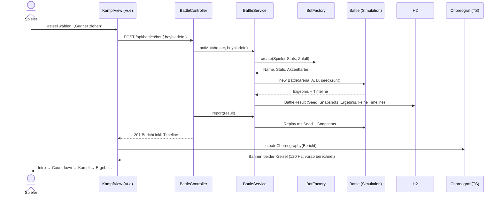

# Kampfsystem

Ein Spieler kämpft mit einem seiner Kreisel gegen einen KI-Gegner mit zufälligen Werten (Schnelles Match)
oder gegen einen anderen Spieler (Lobby). Der Server simuliert den Kampf wahrscheinlichkeitsbasiert und
liefert neben dem Ergebnis eine kompakte **Timeline**. Das Frontend erzeugt daraus mit einem
**deterministischen Choreografen** die 3D-Animation. Das Ergebnis kommt immer vom Server, das Frontend
würfelt nichts, was das Ergebnis beeinflusst.

## Ablauf



`GET /api/battles/{id}` spielt einen gespeicherten Kampf auf dieselbe Weise nach (Replay aus Lobby und
Profil).

## Simulation (`org.example.game`)

### Normalisierung und Stil

Die Stats aus den Teilen liegen in sehr unterschiedlichen Bereichen (Angriff 1–7, Verteidigung 3–12,
Ausdauer 6–16, Dash 2–8, Gewicht 71–86, Burst-Resistenz 2–4). Jeder Wert wird deshalb auf das erreichbare
Maximum normalisiert. `TuningCatalogTest` prüft die Referenzwerte gegen `parts/*.json`.

```
a = attack/7   d = defense/12   s = stamina/16   v = dash/8   b = burstResistance/4
m = (weight − 71) / 15                                  (alle auf [0, 2] begrenzt)

Budget P = a + d + s          Stil σ = (a, d, s) / P
Archetyp = größter Anteil, wenn ≥ 0,42, sonst BALANCE   (nur Anzeige)
```

Die **Matchup-Kante** wird nur für den Hinweis im Intro genutzt:

```
e(X, Y) = σXᵀ · M · σY        M (Zeile schlägt Spalte):
                                     A   D   S
                                A [  0  -1  +1 ]
                                D [ +1   0  -1 ]
                                S [ -1  +1   0 ]
```

M ist antisymmetrisch. Ein Mirror ergibt 0, ein ausgeglichener Stil ergibt gegen jeden Gegner 0. Ab
|e| < 0,05 zeigt die UI „Ausgeglichen“.

### Tick-Simulation

20 Ticks/s, Zeitlimit 35 s, keine KOs vor 12 s (Rampe bis 16 s). Daraus folgt eine Kampfdauer von
12–35 s.

| Phase | Zeit | Verhalten |
|---|---|---|
| Launch | 0–1 s | keine Kollisionen |
| Tornado | 1–3,5 s | seltene, schwache Kontakte (×0,35 Rate, ×0,5 Intensität) |
| Angriff | ab 3,5 s | volle Clash-Rate |
| Ende | | BURST, RING_OUT, SPIN_OUT oder DECISION |

Pro Tick:

```
Reibung   F = F0 · Arena · Jitter · (1 + 0,02·m + 0,03·d) · (1 − 0,11·s) · (1 + 0,8·max(0, 0,3 − E)/0,3)
Clash     P = 1 − exp(−λ·dt),  λ = 0,75 · Phase · Tempo · (0,35 + v_A·(0,3+σA,a) + v_B·(0,3+σB,a))
          mindestens 0,7 s zwischen zwei Clashes
Angreifer P(X) ∝ 0,15 + a_X + 0,5·v_X
Intensität I = 0,95 · (0,3 + 0,6·a + 0,5·m) · (0,75 + 0,25·v) · √E · √(wX/wY) · U(0,65…1,35)
               · (1 − 0,58·σY,s)                     (Ausdauer weicht aus)
Abwehr    P = clamp(0,25 + 0,8·(d_Y − 0,6·a_X), 0,05, 0,85)
            → Angreifer verliert 0,021·I·wY/wX·(0,5+0,5·d_Y), kann sich selbst rausschießen
Treffer   Verteidiger −0,05·I·(1 − 0,45·d_Y), Angreifer −0,025·I
Burst     0,12 · I² · (1 − 0,7·b) · (1 + σY,s) · (1 + 2·(1−E)) · KO-Rampe
Ring-Out  0,08 · I² · (1,4 − m) · (1 − 0,5·d) · (1 + 2·(1−E)) · KO-Rampe · Arena
```

So entsteht Schere-Stein-Papier, ohne feste Sieger:

- **Verteidigung schlägt eher Angriff.** Treffer prallen ab, der Angreifer verliert durch den Rückstoß
  Spin oder schießt sich selbst raus.
- **Ausdauer schlägt eher Verteidigung.** Weniger Reibung, der schwere Verteidiger dreht kürzer.
- **Angriff schlägt eher Ausdauer.** Der leichte, locker gebaute Ausdauer-Kreisel burstet oder fliegt
  raus.

Alle Konstanten stehen kommentiert in `BattleTuning`.

### Determinismus

`new Battle(arena, a, b, seed)` liefert bei gleichem Seed exakt dasselbe Ergebnis und dieselbe Timeline:

- Der Seed wird mit SplitMix64 gemischt, weil aufeinanderfolgende Seeds bei `java.util.Random` sonst
  korrelierte erste Werte liefern.
- Die Simulation nutzt `java.util.Random` (plattformunabhängig spezifiziert) und `StrictMath` statt
  `Math`.
- Seeds sind kleiner als 2⁵³, damit JavaScript sie exakt darstellt.

### Balancing (Monte Carlo, `BattleBalanceTest`)

Reine Archetypen mit gleichem Budget, Seeds 0–4999, beide Seiten-Reihenfolgen:

| Matchup | Vorteil-Typ gewinnt |
|---|---|
| Verteidigung vs Angriff | 68,5 % / 69,0 % |
| Ausdauer vs Verteidigung | 66,7 % / 68,0 % |
| Angriff vs Ausdauer | 63,0 % / 63,5 % |
| Mirrors (A/A, D/D, S/S) | 49,8–50,2 % |

Finish-Mix über alle Paarungen: Spin-Out 45,0 %, Entscheidung 37,9 %, Ring-Out 8,9 %, Burst 8,2 %.
Ein deutlich stärkerer Kreisel gewinnt 195 von 200 Kämpfen.

Gegen KI-Gegner gewinnen echte Teile-Kombinationen zwischen 40 und 62 %. Angriffs-Builds liegen am
unteren Ende, weil die einzige Angriffsklinge (Sturmklinge) auch wenig Verteidigung und Burst-Resistenz
hat.

## KI-Gegner (`BotFactory`)

- Budget = Spieler-Budget × U(0,92; 1,08), nach Rundung garantiert innerhalb von ±10 %.
- Gewichtung: drei Anteile mit Rauschen, einer davon bekommt einen Bias (in 15 % der Fälle keiner).
  Werte über dem Maximum geben ihren Überschuss an die anderen ab.
- Dash, Gewicht und Burst-Resistenz liegen im Teilebereich und hängen am Stil.
- Name aus Adjektiv und maskulinem Substantiv („Eisiger Orkan“), damit die Endung immer stimmt.
  Dazu kommt eine Akzentfarbe für das Platzhalter-Modell.

## Persistenz und Zählregeln

Bot-Gegner werden über den **System-User „KI“** abgebildet:

- `winner`/`loser` bleiben `NOT NULL`. Es braucht keine Migration, und alle bestehenden Stellen laufen
  unverändert.
- Den Namen kann niemand registrieren (die Registrierung verlangt 3–20 Zeichen).
- Das Passwort ist ein Hash eines zufälligen, nicht gespeicherten Geheimnisses, ein Login ist also
  unmöglich.
- Angelegt wird der User von `SystemUserSeeder`.

Neue Spalten in `BattleResult` (alle nullable, damit `ddl-auto=update` sie in bestehenden Datenbanken
ergänzt):

| Spalte | Inhalt |
|---|---|
| `battle_mode` | `PVP` / `BOT`, `null` = Altbestand (zählt als PvP) |
| `sim_seed`, `sim_version`, `arena_id` | alles, was das Replay braucht |
| `duration_ms`, `winner_side` | Ergebnis in der neuen Zeitrechnung |
| `a_*`, `b_*` | Stat-Snapshot, Teile-IDs und Akzentfarbe beider Kämpfer |

Die Timeline wird **nicht** gespeichert. `GET /api/battles/{id}` simuliert neu und liefert die Timeline
nur, wenn `sim_version` passt und Sieger, Finish und Dauer übereinstimmen. Sonst ist `timeline` leer und
nur das Ergebnis wird angezeigt. So widerspricht eine Animation nie einem gespeicherten Ergebnis.
**Bei jeder Tuning-Änderung `BattleTuning.SIM_VERSION` erhöhen.**

Zählregeln:

- **Rangliste:** nur PvP. Die Queries filtern `BOT` heraus, „KI“ taucht deshalb nie auf.
- **Profil:** Siege, Niederlagen, Rang und „% Siege“ sind PvP-Werte. `botWins`/`botLosses` werden
  getrennt angezeigt („Gegen KI“). Die History enthält alle Kämpfe.

## API

| Methode | Pfad | Antwort |
|---|---|---|
| POST | `/api/battles/bot` `{ beybladeId }` | 201, voller Bericht inkl. Timeline |
| GET | `/api/battles/{id}` | voller Bericht, Timeline per Replay |
| POST | `/api/battles/quick` | wie bisher (echter Gegner), Bericht inkl. Timeline |

Fehlercodes:

- 401 „Bitte melde dich an.“
- 400 „Bitte einen Kreisel wählen.“
- 404 „Kreisel X nicht gefunden“ (fremd oder nicht vorhanden)
- 404 „Kampf X nicht gefunden“

### Timeline-Format

```json
{
  "sampleMs": 100,
  "energy": { "A": [0.97, 0.969], "B": [0.94, 0.938] },
  "hits": { "A": 7, "B": 3 },
  "events": [
    { "t": 0, "type": "LAUNCH" },
    { "t": 1000, "type": "TORNADO" },
    { "t": 3500, "type": "ENGAGE" },
    { "t": 4350, "type": "CLASH", "attacker": "A", "intensity": 0.72, "angle": 1.92 },
    { "t": 4350, "type": "DEFLECT", "defender": "B" },
    { "t": 9800, "type": "NEAR_RING_OUT", "victim": "B", "angle": 1.571, "pocket": 0 },
    { "t": 18200, "type": "WOBBLE", "victim": "B" },
    { "t": 21450, "type": "RING_OUT", "victim": "B", "angle": 3.71, "pocket": 1 }
  ]
}
```

- `energy[i]` gehört zu `i · sampleMs`, Werte von 0 bis 1.
- `angle` bei CLASH ist der Polarwinkel des Treffpunkts auf der Bowl (x = r·cos θ, z = r·sin θ). Er wird
  ausgewürfelt, ist ergebnisneutral und wandert plausibel um die Bowl.
- `angle` bei RING_OUT/NEAR_RING_OUT liegt in der Tasche `pocket`.
- Ein DEFLECT mit gleichem `t` direkt nach einem CLASH bedeutet „abgewehrt“.
- Weitere Finish-Events: `BURST`, `SPIN_OUT` (mit `victim`) und `TIMEOUT`.

## Frontend

| Datei | Aufgabe |
|---|---|
| `game/arenas.ts` | Arena-Registry ohne three: Radius, Krümmung, Ridge, Taschen |
| `game/choreographer.ts` | Seed + Timeline → Bahnen, Neigung, Spin, Burst-Teile |
| `game/playback.ts` | Energie-Interpolation, Einblendungen, Textverlauf, Slow-Mo |
| `game/clock.ts`, `game/cameraDirector.ts` | Kampfuhr, Broadcast-Kamera |
| `game/prng.ts` | mulberry32 |
| `components/three/battle/*` | Arena-Geometrie, Szene, Kämpfer, Funken |
| `views/KampfView.vue` | Ablauf: Wählen → Ziehen → Intro → Countdown → Kampf → Ergebnis |

### Choreograf

Alles wird einmal vorab mit 120 Hz berechnet. `sample()` interpoliert nur noch und schreibt in ein
übergebenes Objekt, im Render-Loop wird also nichts alloziert.

1. **Freie Bahn je Kreisel (polar):** Launch vom Rand, Kreisen auf der Tornado-Ridge, danach Radius und
   Tempo aus dem Stil (Verteidiger halten die Mitte, Angreifer fegen weit), langsamer und zur Mitte
   sinkend bei wenig Energie.
2. **Clashes exakt treffen:** Für jeden CLASH wird der Winkel über die Lücke seit dem letzten Clash
   verbogen, der Radius über einen kurzen Anlauf. Zum Event-Zeitpunkt berühren sich beide genau am
   Treffpunkt. Die Stoßrichtung folgt der Anordnung vor dem Anlauf, niemand muss die Seite wechseln.
   Danach prallen beide ab, stärker für den Leichteren und für einen abgewehrten Angreifer.
3. **Abstand halten:** Außerhalb der Kontaktmomente drücken sich die Kreisel weg, statt sich zu
   durchdringen. Die Seitenordnung bleibt dabei stetig.
4. **Finish:**
   - SPIN_OUT: Der Verlierer rollt aus und kippt um.
   - DECISION: Beide werden langsamer, der Sieger dreht weiter.
   - RING_OUT: Ballistischer Bogen in die Tasche aus der Timeline.
   - BURST: Wheel, Track und Tip fliegen mit Impuls, Schwerkraft und Dämpfung auseinander und rutschen
     zur Mitte.
5. **Neigung und Spin:** In die Kurve legen, Präzession und Nutation ∝ (1 − E), Stoß-Kippen bei
   Treffern, Spin-Rate ∝ E^0,7.

Effekte und Kamera kommen danach in der Szene dazu:

- Funken als ein `LineSegments`-Pool und ein kurzes PointLight als Blitz.
- Kamera-Shake ∝ Intensität, Slow-Mo bei Intensität ≥ 0,8 und nach dem Finish.
- Die Broadcast-Kamera pausiert, sobald man mit OrbitControls dreht. Ein Doppelklick schaltet zurück.

### Fallbacks

- **`prefers-reduced-motion`:** Direkt Ergebnis plus Textverlauf. „Animation ansehen“ spielt eine
  ruhige Version (kein Shake, kein Blitz, kein Slow-Mo, kurzer Countdown).
- **Ohne WebGL:** Textverlauf, der im Takt der Kampfuhr mitläuft, dazu die HUD-Balken.

## Neue Arena hinzufügen

1. `Arena.java`: neuen Eintrag in `ALL` (ID, Name, Reibungs- und Ring-Out-Faktor, Taschenwinkel).
2. `src/frontend/src/game/arenas.ts`: gleiche ID in `ARENAS` mit Geometrie (Radius, Krümmung, Ridge,
   Taschen).
3. Die Arena-Auswahl im `BattleService` ist aktuell fest `Arena.standard()`. Dort die Wahl ergänzen.
4. Da die Arena-ID pro Kampf gespeichert wird, bleiben alte Replays gültig.
