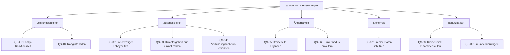

# Qualitätsbaum 

## 1. Qualitätsbaum

### Priorisierung wie in der Vorlesung

*GNut* = geschäftlicher Nutzen; *TRis* = technisches Risiko. **Hoch** bedeutet besonders wichtig bzw. technisch anspruchsvoll. Die Prioritäten sind Einschätzungen des Projektteams, keine Messergebnisse.

| Qualitätsattribut | Verfeinerung | Qualitätsszenario (Kurzform) | GNut | TRis |
|---|---|---|---|---|
| Leistungsfähigkeit | Reaktionszeit der Lobby | **QS-01:** Lobby bei normaler Last innerhalb von 2 s erstellen oder betreten | Hoch | Mittel |
| Leistungsfähigkeit | Reaktionszeit der Rangliste | **QS-10:** Rangliste mit 1.000 gespeicherten Ergebnissen innerhalb von 2 s laden | Mittel | Mittel |
| Zuverlässigkeit | Konsistenz des Lobbyzustands | **QS-02:** Zwei gleichzeitige Beitritte auf den letzten Platz führen zu genau einer erfolgreichen Aufnahme | **Hoch** | **Hoch** |
| Zuverlässigkeit | Korrekte Ergebnisverarbeitung | **QS-03:** Wiederholt gesendetes Kampfergebnis verändert die Rangliste nur einmal | **Hoch** | **Hoch** |
| Zuverlässigkeit | Umgang mit Netzwerkfehlern | **QS-04:** Unterbrechung wird erkannt und angezeigt; kein ungültiger Matchstart | Hoch | Mittel |
| Änderbarkeit | Neue Kreiselteile | **QS-05:** Ein neues Kreiselteil lässt sich ohne Änderung an Lobby oder Rangliste integrieren | Hoch | Mittel |
| Änderbarkeit | Neue Spielmodi | **QS-06:** Eine neue Turniervariante kann ohne Änderung der grundlegenden Kampfauswertung ergänzt werden | Mittel | Hoch |
| Sicherheit | Berechtigungsprüfung | **QS-07:** Fremde Kreisel und Kampfergebnisse lassen sich nicht unbefugt ändern | Hoch | Hoch |
| Benutzbarkeit | Baukasten-Bedienung | **QS-08:** Neue Spielende können ohne Anleitung einen vollständigen Kreisel erstellen | Hoch | Niedrig |
| Benutzbarkeit | Freunde-Funktion | **QS-09:** Eine Freundesanfrage lässt sich schnell und verständlich senden | Mittel | Niedrig |

## 2. Vollständige Qualitätsszenarien

Jedes Szenario folgt dem Schema **Quelle – Auslöser – Artefakt – Umgebung – Antwort – Antwortmaß**.

### QS-01: Lobby-Reaktionszeit
- **Quelle:** Angemeldeter Spieler.
- **Auslöser:** Er erstellt eine Lobby oder tritt einer vorhandenen Lobby bei.
- **Artefakt:** LobbyView, LobbyController, LobbyService und zugehörige Zustandsverwaltung.
- **Umgebung:** Normalbetrieb in einer festgelegten Testumgebung mit bis zu 20 gleichzeitig aktiven Spielern.
- **Antwort:** Das System verarbeitet die Anfrage und zeigt den aktuellen Lobbyzustand an.
- **Antwortmaß:** Mindestens 95 % von 100 Testanfragen werden innerhalb von **2 Sekunden** bestätigt oder mit einer verständlichen Fehlermeldung beantwortet.

### QS-02: Gleichzeitiger Beitritt auf den letzten freien Lobbyplatz
- **Quelle:** Zwei Spieler.
- **Auslöser:** Beide versuchen nahezu gleichzeitig, den letzten verfügbaren Platz derselben Lobby zu belegen.
- **Artefakt:** LobbyService und zentral verwalteter Lobbyzustand.
- **Umgebung:** Laufender Mehrspielerbetrieb; die Lobby hat genau einen freien Platz.
- **Antwort:** Nur eine Anfrage wird angenommen. Die andere wird mit einer passenden Meldung abgelehnt; die maximale Teilnehmerzahl bleibt eingehalten.
- **Antwortmaß:** Bei **100 von 100** simulierten Parallelbeitritten wird **genau ein** Spieler aufgenommen und **kein** überzähliger Spieler zugelassen.

### QS-03: Kampfergebnis nur einmal werten
- **Quelle:** Ergebnisverarbeitung nach einem beendeten Kampf; mögliches wiederholtes Absenden durch Verbindungsprobleme.
- **Auslöser:** Dasselbe abgeschlossene Kampfergebnis wird mehrmals zur Speicherung übermittelt.
- **Artefakt:** Ergebnisverarbeitung, Ergebnisablage und Ranglistenberechnung.
- **Umgebung:** Normalbetrieb oder erneuter Übertragungsversuch nach einem Netzwerkfehler.
- **Antwort:** Ein bereits gespeichertes Kampfergebnis wird erkannt und nicht erneut gewertet.
- **Antwortmaß:** In **100 von 100** Tests mit doppelt übermittelter eindeutiger Kampf-ID wird **genau ein** Ergebnis gespeichert und die Rangliste **genau einmal** verändert.

### QS-04: Verbindungsabbruch in einer Lobby
- **Quelle:** Netzwerk bzw. Spielergerät.
- **Auslöser:** Die Verbindung eines Spielers wird unterbrochen.
- **Artefakt:** Lobby- und Verbindungsverwaltung.
- **Umgebung:** Spieler befindet sich in einer Lobby vor Matchbeginn.
- **Antwort:** Das System erkennt den nicht erreichbaren Teilnehmer, zeigt einen Verbindungsstatus und startet keinen Kampf mit einem ungültigen Teilnehmerzustand.
- **Antwortmaß:** In der Testumgebung erscheint spätestens **10 Sekunden** nach einer erkannten Verbindungsunterbrechung eine verständliche Statusanzeige; in **10 von 10** Testfällen wird kein Match aus einem inkonsistenten Lobbyzustand gestartet.

### QS-05: Neues Kreiselteil ergänzen
- **Quelle:** Entwickler.
- **Auslöser:** Ein zusätzliches Teil einer bereits vorhandenen Kategorie, beispielsweise ein weiteres Fusion Wheel, soll verfügbar werden.
- **Artefakt:** Teiledaten, PartService, passendes Repository und Baukastenansicht.
- **Umgebung:** Geplante Weiterentwicklung während des Projekts.
- **Antwort:** Das neue Teil wird mit seinen Werten aufgenommen und im Baukasten angeboten.
- **Antwortmaß:** Das Ergänzen eines Teils dauert höchstens **2 Stunden** und erfordert **keine Änderung** der Lobby-, Ergebnis- oder Ranglistenlogik.

### QS-06: Neue Turniervariante ergänzen
- **Quelle:** Entwickler.
- **Auslöser:** Für den Solo-Cup wird eine zusätzliche Turniervariante bzw. ein anderer Turnierablauf benötigt.
- **Artefakt:** Turniersteuerung und bestehende Kampfauswertung.
- **Umgebung:** Weiterentwicklung nach dem ersten spielbaren Turnierablauf.
- **Antwort:** Der neue Ablauf kann auf die bestehende Kampfauswertung zurückgreifen.
- **Antwortmaß:** Eine neue, vergleichbar komplexe Variante lässt sich innerhalb von **2 Personentagen** ergänzen, ohne die grundlegende Ergebnislogik des einzelnen Kampfes zu verändern.

### QS-07: Unbefugte Änderungen verhindern
- **Quelle:** Angemeldeter Benutzer bzw. manipulierter Client.
- **Auslöser:** Der Client versucht, den Kreisel eines anderen Spielers zu verändern oder ein nicht autorisiertes Kampfergebnis einzutragen.
- **Artefakt:** Controller-/Service-Berechtigungsprüfung und Datenhaltung.
- **Umgebung:** Normalbetrieb mit gültiger Anmeldung, aber ohne Rechte für die angeforderte Änderung.
- **Antwort:** Die Änderung wird verweigert und bestehende Daten bleiben unverändert.
- **Antwortmaß:** In **20 von 20** negativen Berechtigungstests werden unzulässige Änderungen abgelehnt und **0** fremde Datensätze verändert.

### QS-08: Kreisel ohne Anleitung erstellen
- **Quelle:** Neuer Spieler.
- **Auslöser:** Er öffnet erstmals den Kreisel-Baukasten.
- **Artefakt:** Baukastenansicht und Kreisel-Erstellungsprozess.
- **Umgebung:** Erster Nutzungsversuch ohne persönliche Einführung.
- **Antwort:** Der Spieler kann die benötigten Einzelteile auswählen, seine Werte sehen und den Kreisel speichern.
- **Antwortmaß:** Mindestens **4 von 5** Testpersonen erstellen in **höchstens 3 Minuten** selbstständig einen vollständigen Kreisel.

### QS-09: Freundesanfrage senden
- **Quelle:** Angemeldeter Spieler.
- **Auslöser:** Er möchte einen anderen Spieler als Freund hinzufügen.
- **Artefakt:** Freunde-Ansicht und Anfrageverwaltung.
- **Umgebung:** Normalbetrieb; der Zielspieler ist über die Suche auffindbar.
- **Antwort:** Der Spieler findet den Zielspieler, sendet eine Einladung und erhält sichtbares Feedback.
- **Antwortmaß:** Mindestens **4 von 5** Testpersonen erledigen die Aufgabe in **höchstens 60 Sekunden** ohne Hilfe.

### QS-10: Rangliste zügig anzeigen
- **Quelle:** Angemeldeter Spieler.
- **Auslöser:** Er öffnet die Rangliste.
- **Artefakt:** Ranglistenansicht, zugehöriger Service und Ergebnisablage.
- **Umgebung:** Testsystem mit **1.000** gespeicherten Kampfergebnissen.
- **Antwort:** Die Rangliste wird aus den vorhandenen Ergebnissen geladen und angezeigt.
- **Antwortmaß:** In mindestens **95 %** von 100 Abrufen wird die Rangliste innerhalb von **2 Sekunden** angezeigt.

## 3. Für Schritt 2 ausgewählte Szenarien

**Höchste Priorität:**
1. **QS-02 – Konsistenter Lobby-Beitritt** (hoher Nutzen / hohes technisches Risiko). Ohne verlässliche Teilnehmerverwaltung funktionieren Mehrspieler-Kämpfe nicht zuverlässig.
2. **QS-03 – Kampfergebnisse nur einmal werten** (hoher Nutzen / hohes technisches Risiko). Falsch oder doppelt gezählte Ergebnisse machen Rangliste und Turnierfortschritt unglaubwürdig.

Die passenden Architekturstrategien, Entwurfsmuster und Entscheidungen sind in [architekturentscheidungen.md](architekturentscheidungen.md) und in den ADRs dokumentiert.
